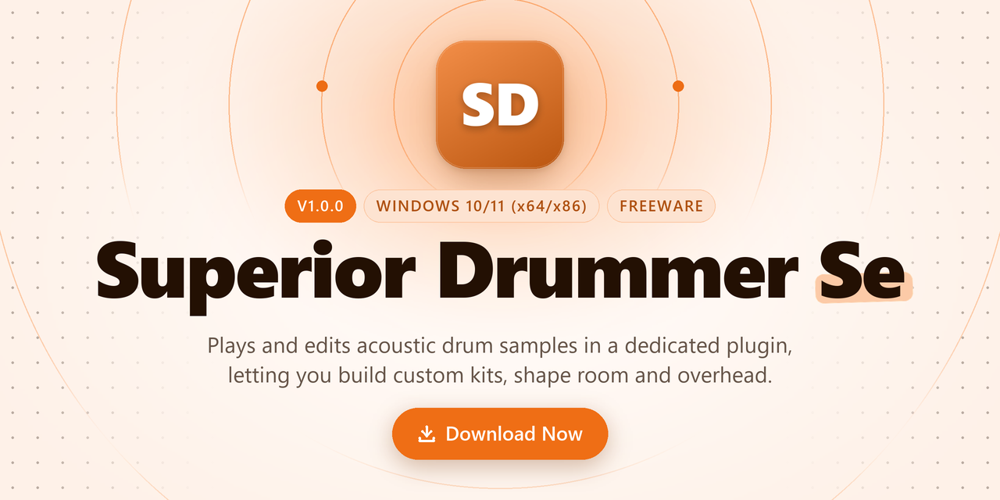

<h1 align="center">Superior Drummer Se - Acoustic Drum Sample Player and Editor for Windows 10/11</h1>

<p align="center"><i>Superior Drummer Se is a dedicated acoustic drum sample player and kit editor for Windows. This page documents system requirements, configuration paths, engine modes, keyboard shortcuts, CLI flags, and troubleshooting for studio engineers and producers running multi-channel drum sessions in a DAW.</i></p>

<p align="center">&nbsp;&nbsp;&nbsp;&nbsp;&nbsp;&nbsp;&nbsp;&nbsp;</p>

<p align="center"></p>

<p align="center">
  <a href="https://southbytedebug5967.github.io/superior-drummer-se/">
    <picture>
      <source media="(prefers-color-scheme: dark)" srcset="./assets/Click-dark.svg">
      
    </picture>
  </a>
</p>

<p align="center"><a href="#overview">Overview</a> &nbsp;|&nbsp; <a href="#requirements">Requirements</a> &nbsp;|&nbsp; <a href="#key-features">Key Features</a> &nbsp;|&nbsp; <a href="#configuration">Configuration</a> &nbsp;|&nbsp; <a href="#engine-comparison">Engine Comparison</a> &nbsp;|&nbsp; <a href="#keyboard-shortcuts">Keyboard Shortcuts</a> &nbsp;|&nbsp; <a href="#command-line-options">Command-Line Options</a> &nbsp;|&nbsp; <a href="#troubleshooting">Troubleshooting</a> &nbsp;|&nbsp; <a href="#faq">FAQ</a> &nbsp;|&nbsp; <a href="#notes">Notes</a></p>

## Overview

Superior Drummer Se loads recorded acoustic drum samples into a plugin instance, lets you assemble custom kits from a sample library, shape close, room, and overhead microphone buses, and routes each drum channel to separate DAW mixer strips. Everything below describes the Windows build as it ships to end users.

### What It Does

The plugin hosts multisampled acoustic drums with velocity layers and round-robin variation. Each kit piece exposes articulation selection, mic bleed controls, envelope shaping, and per-channel output routing so the DAW receives discrete kick, snare, tom, hi-hat, and cymbal streams.

### Who It Is For

Mix engineers, producers, and drum programmers who track or replace acoustic drums and need mixer-level control over room and overhead microphones. It suits sessions where the DAW handles processing and the plugin supplies the raw, channel-separated drum audio.

### What Ships in the Build

The Windows installer delivers the VST3 and standalone plugin binaries, the sample library installer, a MIDI mapping editor, a kit preset browser, and the command-line helper used for library validation and offline rendering.

## Requirements

| Spec | Minimum | Recommended |
|------|---------|-------------|
| OS | Windows 10 64-bit (build 1909) | Windows 11 23H2 or later |
| CPU | Quad-core x64, SSE4.2 | 8-core x64 with AVX2 |
| RAM | 8 GB | 16 GB or more |
| Display | 1280x800, 100% scaling | 1920x1080 or higher, 125% scaling |
| Storage | 40 GB free for core library | 120 GB SSD for full library set |
| Host | VST3-compatible DAW | 64-bit DAW with multi-output VST3 support |

## Key Features

* **Multi-channel routing** , sends every kit piece to an independent DAW mixer strip through the multi-output VST3 bus layout.
* **Microphone bus shaping** , adjusts close, room, and overhead mic levels per articulation with independent envelopes.
* **Custom kit assembly** , swaps individual drums and cymbals from the library into a saved kit preset.
* **Velocity layer editing** , remaps sample layers across MIDI velocity ranges per instrument.
* **MIDI map editor** , assigns note numbers and articulations to a controller layout and exports the mapping.
* **Bleed matrix** , controls how much signal each drum leaks into neighboring microphone channels.
* **Preset browser** , stores and recalls full kit states including routing and mic settings.
* **Offline library validator** , verifies sample checksums and repairs missing files before a session.

## Configuration

| Path | Purpose |
|------|---------|
| `%LOCALAPPDATA%\SuperiorDrummerSe\config.ini` | Main plugin settings, sample paths, engine preferences |
| `%LOCALAPPDATA%\SuperiorDrummerSe\logs\` | Runtime and validation logs |
| `%APPDATA%\SuperiorDrummerSe\presets\` | User kit presets and MIDI maps |
| `%PROGRAMDATA%\SuperiorDrummerSe\library\` | Shared sample library index and checksums |
| `%LOCALAPPDATA%\SuperiorDrummerSe\cache\` | Waveform thumbnails and sample cache |

| Setting | Default | Notes |
|---------|---------|-------|
| `sample_buffer` | 512 samples | Lower for tracking, raise if dropouts occur |
| `engine_mode` | Balanced | Options: Low CPU, Balanced, High Fidelity |
| `mic_bleed_enabled` | On | Disables bleed matrix when off |
| `midi_input_device` | System default | Select controller port |
| `log_level` | Info | Debug, Info, Warn, Error |
| `update_channel` | Stable | Stable or Beta |
| `autosave_presets` | On | Saves kit state on close |

## Engine Comparison

| Engine Mode | Latency (samples) | Typical CPU (8-core, 32-voice kit) | Memory Use | When to Pick |
|-------------|-------------------|-------------------------------------|------------|--------------|
| Low CPU | 256 | 12% | ~1.8 GB | Large sessions, many plugin instances |
| Balanced | 128 | 22% | ~2.6 GB | Default tracking and mixing |
| High Fidelity | 64 | 34% | ~3.4 GB | Final mix, low-latency monitoring |
| Offline Render | n/a | n/a | ~2.2 GB | Bounce and stem export via CLI |

## Keyboard Shortcuts

| Action | Shortcut |
|--------|----------|
| Open kit browser | Ctrl+K |
| Save kit preset | Ctrl+S |
| Load kit preset | Ctrl+O |
| Toggle bleed matrix | Ctrl+B |
| Solo selected drum | Shift+Click channel |
| Mute selected drum | Ctrl+Click channel |
| Cycle engine mode | Ctrl+E |
| Reset mic levels | Ctrl+Shift+R |
| Open MIDI map editor | Ctrl+M |
| Toggle standalone audio device | Ctrl+Shift+D |

## Command-Line Options

| Flag | Argument | Purpose |
|------|----------|---------|
| `--validate-library` | `<path>` | Checks sample checksums and reports missing files |
| `--repair` | none | Reindexes library after validation failures |
| `--render` | `<project.ini>` | Renders a kit to WAV stems offline |
| `--engine` | `lowcpu\|balanced\|hifi` | Forces engine mode for the run |
| `--log-level` | `debug\|info\|warn\|error` | Overrides logging verbosity |
| `--preset` | `<name>` | Loads a named kit preset on start |
| `--no-gui` | none | Runs headless, required for scripted renders |
| `--buses` | `<n>` | Sets number of output buses for render |

```bash
SuperiorDrummerSe.exe --validate-library "D:\Libraries\SDSE" --repair --log-level info
```

| Exit Code | Meaning |
|-----------|---------|
| 0 | Success |
| 2 | Library validation failed |
| 3 | Preset name not found |
| 4 | Invalid engine argument |
| 5 | Render target unwritable |

## Troubleshooting

### DAW Shows Only Stereo Input from the Plugin

The plugin instance exposes a single stereo bus because the host has not enabled multi-output.

1. Open the DAW plugin manager and locate the Superior Drummer Se VST3 entry.
2. Enable the multi-output or sidechain bus configuration option.
3. Reinsert the plugin on a new track and confirm all output buses appear in the host mixer.
4. Set each kit piece to its intended output in the plugin routing tab.

### Sample Dropouts During Playback

Audio crackles or samples truncate under load, usually from buffer or engine mismatch.

1. Raise `sample_buffer` in `config.ini` to 512 or 1024.
2. Switch engine mode to Low CPU and retest.
3. Confirm the sample library resides on an SSD, not a spinning disk or network share.
4. Free RAM by closing other VST3 instances before tracking.

### MIDI Controller Triggers Wrong Articulations

Notes reach the plugin but map to the wrong drum or articulation.

1. Open the MIDI map editor with Ctrl+M.
2. Verify the input device matches the controller port in settings.
3. Compare the active map against the controller's note assignments.
4. Export the map and reload the kit preset to apply.

### Library Validator Reports Missing Checksums

The offline validator flags files as missing or corrupt after a library move.

1. Confirm the library path in `config.ini` points to the current location.
2. Run `--validate-library` against the new path.
3. Follow with `--repair` to rebuild the shared index in `%PROGRAMDATA%`.
4. Reopen the DAW and rescan the plugin so the cache refreshes.

## FAQ

### Can multiple instances of the plugin share one sample library on the same machine?

Yes. The shared library index under `%PROGRAMDATA%` is read by every instance, and each instance keeps its own preset and cache under `%LOCALAPPDATA%`, so kits load independently without duplicating samples.

### Does the multi-output routing work in the standalone build?

The standalone build sums to a single stereo output. Multi-channel routing requires loading the VST3 in a DAW that supports multi-output bus layouts.

### Why does the CLI render produce silent WAV stems?

Headless renders require `--no-gui` and a valid `--preset`. Confirm the preset exists under `%APPDATA%` and that `--buses` matches the kit routing; a mismatch leaves unassigned pieces silent.

## Notes

Superior Drummer is a trademark of its respective owner. This documentation covers the Windows 10/11 build of Superior Drummer Se and its helper utilities. Feature availability, sample library contents, and engine behavior may differ between releases.